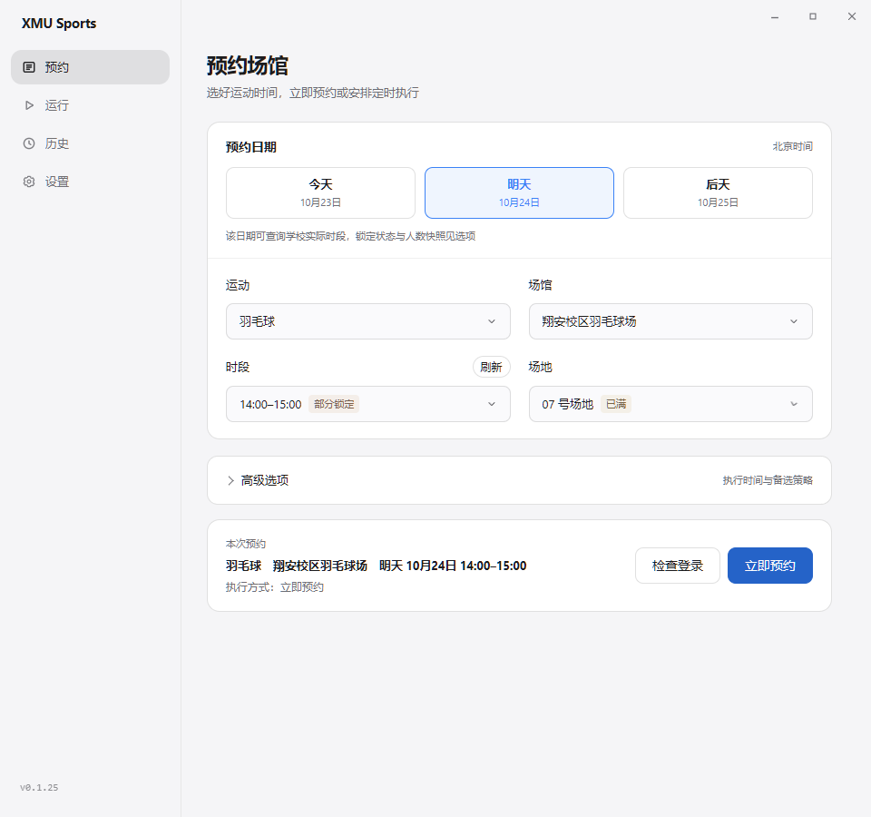
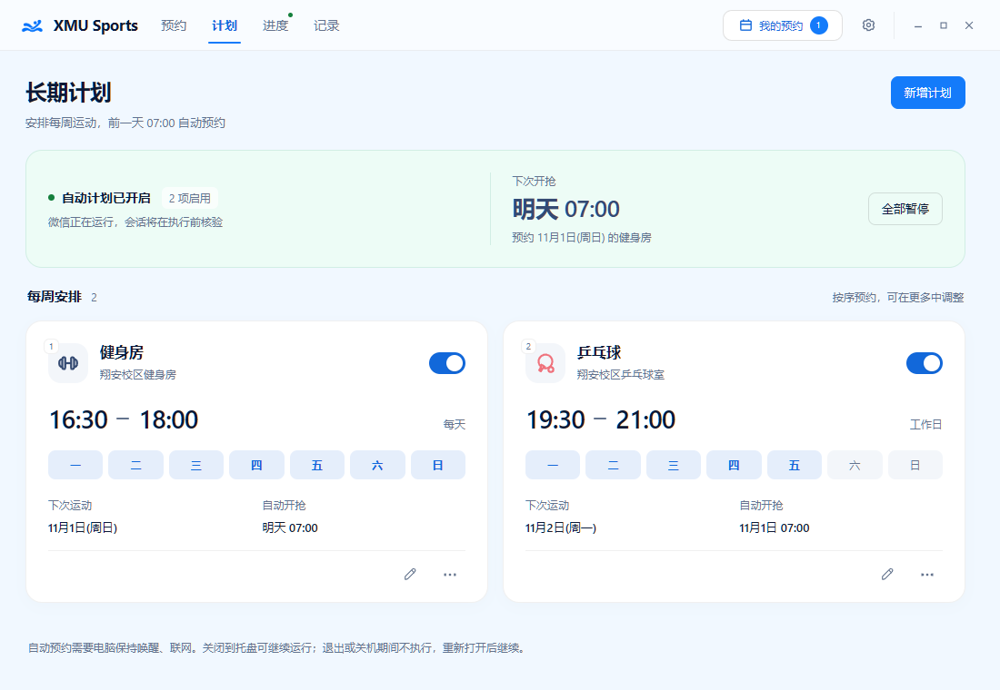
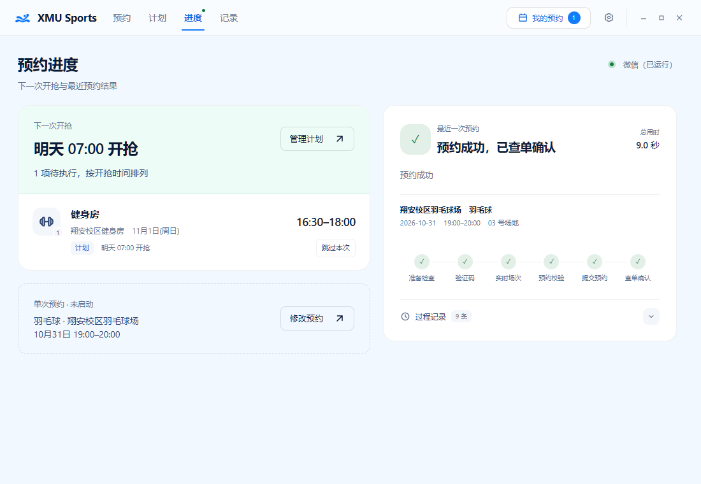
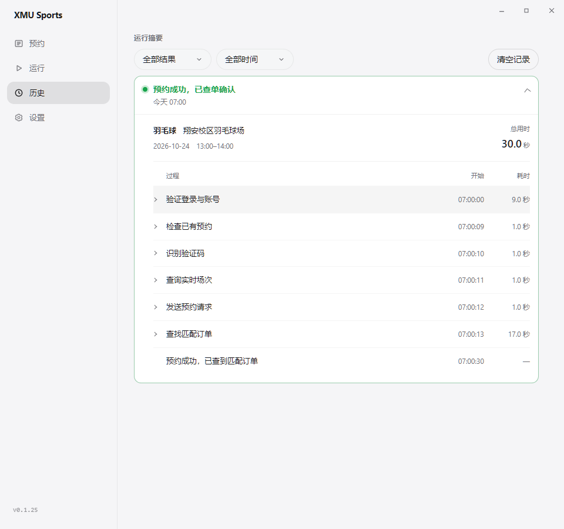

# XMU Sports｜厦大体育场馆预约助手

把临时预约、每周运动安排和预约记录放在一起，让场馆预约更省心。

XMU Sports 是面向厦大师生的 Windows 桌面预约助手，支持单次预约、定时开抢、长期计划和场次查询，适用于 Windows 10/11 x64。

A Windows desktop companion for Xiamen University sports venue booking, with scheduled reservations, weekly plans, court availability and booking history.

**[下载最新版](https://github.com/MidiAug/xmu-sports/releases/latest) · [版本动态](https://github.com/MidiAug/xmu-sports/releases)**

## 主要功能

- **单次预约**：选择运动、场馆、日期和时段，立即预约或定时执行，并按需要设置场地偏好与执行延迟。
- **长期计划**：按每天、工作日、周末或自选星期安排运动，自动在开抢时间执行；可调整优先级、暂停计划或跳过本次。
- **场次查询**：查看各场馆的时段、场地和余量，集中选择羽毛球、乒乓球、健身房等运动项目。
- **我的预约**：集中查看当前账号的预约，刷新预约状态，管理不再需要的场次。
- **预约进度**：查看下次开抢时间、待执行任务和本轮预约结果，多项运动的结果分别展示。
- **活动记录**：按时间和结果回看预约过程，展开查看各阶段状态与耗时。
- **日常体验**：支持托盘运行、开机启动、浅色与深色主题，以及应用内版本更新。

## 界面预览

以下为示例界面，账号、场次与预约结果均为模拟数据。

### 预约

运动、场馆、日期和时段集中选择，右侧查看本次预约目标与执行方式。

### 计划

每周运动安排、下次运动日期与开抢时间一目了然，随时调整计划与优先级。

查看预约进度与活动记录

### 进度

集中查看待执行任务，并在同一张卡片中了解预约过程与最终结果。

### 记录

按结果和时间筛选，展开查看每次预约的过程与耗时。

---

独立的非官方应用，仅用于本人或已授权账号的场馆预约，请遵守学校预约规则。

[软件许可协议](EULA.txt)
