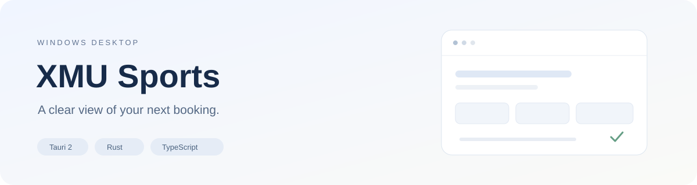
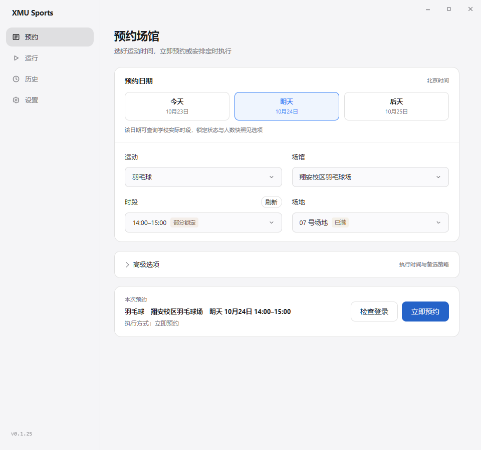
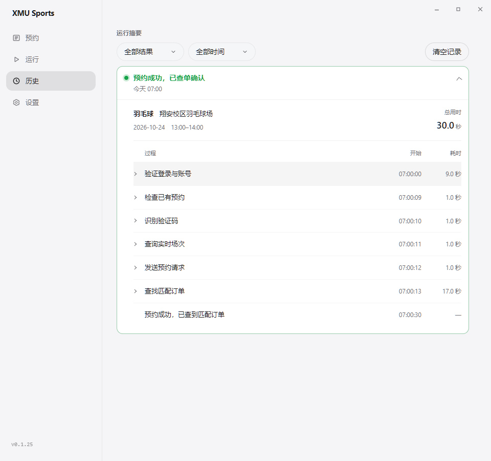

# XMU Sports｜厦大体育场馆预约助手



[](https://github.com/MidiAug/xmu-sports/actions/workflows/checks.yml)

厦大体育场馆预约辅助桌面应用，面向 Windows 10/11。使用 Tauri 2、TypeScript、Rust 和 Python HTTP 执行器。非学校官方应用，仅用于本人或已授权账号，请遵守学校的预约规则。

A Windows desktop companion for Xiamen University (XMU) sports venue booking, with scheduled reservations, court availability and local history. An independent, unofficial project.

## 功能

- 配置运动、场馆、日期、时段和场地，支持定时任务及 0–300 秒执行延迟。
- 北京时间0–7点，今天/明天安排今天07:00执行，后天安排明天07:00并提示多等一天；7–24点今天/明天可立即执行，后天可安排定时。跨零点保留有效的实际目标日期，相对标签自动变化；最终是否可约由学校实时状态校验。
- 查询今天和明天的场次。管理员锁定与人数已满分开显示：全锁时段不可选，部分锁定标记具体场地，已满仍可选。
- 场次按账号、场馆和实际日期持久缓存，重启及跨天可复用；一次查询复用今天和明天，切换已缓存日期不重复请求。手动刷新更新快照（连续刷新至少间隔5秒），正式预约另查实时余量。
- 凭证过期后可单独重新登录，成功后自动刷新场次；这个入口不执行预约。
- 历史先显示摘要，展开时加载过程；按阶段展示执行过程、时间和耗时；上游错误回复经脱敏后保存在本地诊断中。
- 提交响应不明时先查单确认，无法确认则保留待确认状态，避免盲目重下。
- 正式版启动30秒后按到期时间自动检查更新，成功后间隔24小时、失败后1小时重试，重启保留冷却，预约期间推迟检查；检测到更新时在侧栏版本号旁提示。也可在「设置 → 关于」手动检查、下载并查看进度，校验通过后点击“退出并安装”，预约或登录进行中会阻止安装。
- 开发分支新增（见 Unreleased）：更新下载可选择内置镜像，默认空闲时自动下载安装包；已校验安装包在重启后复核复用。真正退出时可选择安装或直接退出，最小化到托盘不打扰，始终不会自动安装。

## 界面预览

以下图片由程序使用**模拟数据**渲染，不含真实账号、预约记录或微信截图。

| 预约配置 | 历史记录 |
| --- | --- |
|  |  |
| 日期、时段、场地与锁定状态 | 阶段过程、开始时间与耗时 |

## 使用

需要 PC 微信和 WebView2。安装包包含 HTTP 执行器及必要验证码分类模型，使用者无需安装 Python。可从 [Releases](https://github.com/MidiAug/xmu-sports/releases) 获取已发布版本；若尚无版本，请使用开发模式。

首次使用需要在微信小程序完成登录。程序显示并前置小程序，使用 Windows UI Automation 恢复登录，每次操作前重新确认窗口身份和前台焦点，不移动鼠标；微信没有提供可操作元素时会提示手动完成。自动登录期间，小程序上方显示“正在登录中，请稍候”及当前阶段；请暂勿操作小程序，流程结束后提示自动消失。已有小程序最小化时先还原，登录与 HTTP 原账号核验完成后自动尝试关闭小程序窗口；关闭后再次核验会话。

开始前请完成以下准备：

1. 在电脑微信打开「厦大体育」小程序，确认页面能完整显示，尤其是「场馆预约」等入口。若出现异常放大、内容裁切或入口显示不全，请先恢复正常缩放和窗口大小，再使用本程序。
2. 点击小程序右上角「…」→「添加到电脑桌面」，保留桌面快捷方式，供后续唤起小程序使用。

侧栏下方「我的预约」显示当前账号已预约且未核销的场次，以紧凑卡片显示具体场馆、场地和时段，日期优先显示“今天／明天／后天”，按开始时间从早到晚排列，结束后本地移除。订单快照按账号隔离，普通时段30分钟内复用，北京时间07:00–07:15缩短为5分钟；窗口可见且空闲、快照过期时同步，切回窗口不反复拉取，空列表同样缓存。软件内提交或查单发现变化时刷新，确认取消后直接移除目标卡片；小程序里的变化通过过期同步或手动刷新获取。顶部刷新图标在请求期间旋转，手动刷新绕过缓存并保留10秒防连点；已结束订单不重复查询详情。登录失效时复用登录恢复并重查一次，后台仅提示，不自行唤起微信。预约和定时期间暂停查询与取消。距离开始严格超过1小时才可取消，确认弹窗后仍向学校核验状态和时限；结果不明先查单核对，不重复取消。

学校数据与登录方式可能变化；人数是查询时快照，不能保证最终预约成功。任务只在应用运行时执行，请保持电脑唤醒及网络连接。

## 长期计划与开机自启（未发布）

当前源码新增独立的“单次预约”和“长期计划”导航。长期计划选择运动、场馆、时段及去运动的星期，支持每天、工作日、周末或自选星期；保存并启用后，在运动日前一天北京时间07:00按优先级依次尝试预约。一天可有多种运动，同一账号每项运动每天只安排一次。页面显示下次开抢与运动日；列表可拖动排序，也可在“更多”中上下移动或跳过明确日期；支持全部暂停和单项停用。准备开始后本轮目标与顺序已冻结，编辑从下一轮生效。

首次保存新计划会只读核验当前账号；如果提示登录失效，请先回单次预约检查登录，再保存。后续执行始终绑定该账号。学校已有同运动同日订单时跳过，不因计划换了时段或场馆重复下单。提交结果待确认会暂停队列，计划页顶部显示处理入口；请先到“我的预约”或小程序核对，再选择“已核对并跳过”，最后恢复其他计划。窄窗口点击“我的预约”展开完整订单。

“设置 → 启动与后台”可开启登录Windows后自启，并选择自动启动进入托盘。手动打开会显示主窗口；安装版重复启动只唤起现有实例。托盘提供计划暂停/恢复与下次开抢时间。开发版不注册开机启动项。

有启用的计划时，后台每分钟只检测本机微信状态；开抢前五分钟未检测到微信会提醒一次，执行前仍单独核验预约会话，每轮结束汇总通知。请保持电脑开机、唤醒和联网；关机、睡眠或退出后不能准点执行。离线恢复只补尝试当天应开抢的轮次，不追溯更早的漏约，也不会重发未确认的提交。

## 开发模式

准备 Node.js 22、Rust stable（MSVC 工具链）、Python 3.12 x64、Git，以及 Visual Studio 的“使用 C++ 的桌面开发”和 WebView2。

```powershell
npm ci
npm run ensure-http-bundle
npm run tauri:dev
```

首次准备执行器会创建项目内 Python 环境并下载依赖。平时调整界面继续运行 `tauri:dev`，无需修改版本号或制作安装包。只看前端可运行 `npm run dev`；没有 Tauri 宿主时不能执行真实预约。

## 检查与构建

```powershell
npm test
npm run build
cargo test --manifest-path src-tauri/Cargo.toml -p xmu-sports --lib
cd src-tauri/sidecars/http-booking
.venv/Scripts/python.exe -m pip install -r requirements-dev.txt
.venv/Scripts/python.exe -m pytest -q
```

上述宿主检查需要先准备执行器资源。单元测试使用模拟数据，不应触发真实预约。浏览器交互、安装升级及真实微信登录需要另外验证，详见 [贡献说明](CONTRIBUTING.md)。

确需生成 Windows NSIS 安装包时执行 `npm run tauri:build`，输出位于 `src-tauri/target/release/bundle/nsis/`。安装新版前退出应用，安装器保留个人任务配置和历史。

## 源码结构

| 路径 | 用途 |
| --- | --- |
| `src/` | 页面、配置、历史与场次状态 |
| `src-tauri/src/` | Tauri 宿主、调度、登录与诊断 |
| `src-tauri/sidecars/http-booking/` | 正式 HTTP 执行器、模型及离线测试 |
| `scripts/` | 检查与资源构建脚本 |
| `src-tauri/vision-runtime/` | 历史视觉工作区，保留编译依赖关系，不作为当前产品执行入口 |

公开仓库不包含内部研究记录、AI 协作规则、用户数据库、会话、原始抓包和现场截图。请勿在 Issue 中粘贴 Cookie、完整票据、个人信息或未检查的日志包。

[更新记录](CHANGELOG.md)　[贡献说明](CONTRIBUTING.md)　[CI/CD](.github/CI_CD.md)　[第三方说明](THIRD_PARTY_NOTICES.md)

## 许可证

项目自身代码使用 [MIT License](LICENSE)，第三方模型和依赖保留各自许可证。
