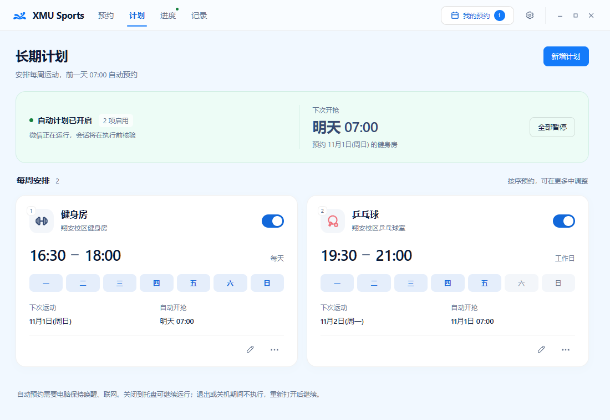
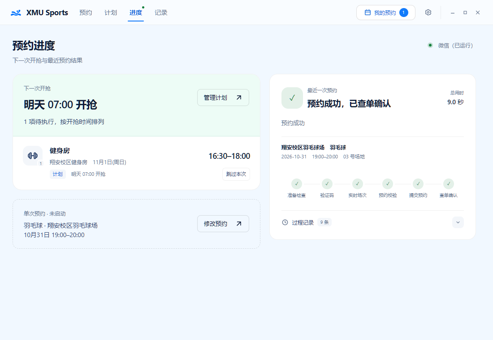

# XMU Sports｜厦大体育场馆预约助手

[](https://github.com/MidiAug/xmu-sports/actions/workflows/checks.yml)
[](https://github.com/MidiAug/xmu-sports/releases/latest)

面向 Windows 10/11 x64 的厦大体育场馆预约辅助应用，支持单次预约、每周计划、场次查询与预约记录。独立开源项目，非学校官方应用；仅用于本人或已授权账号，请遵守学校的预约规则。

A Windows desktop companion for Xiamen University sports venue booking, with recurring plans, scheduled reservations, court availability and local history. An independent, unofficial project.

**[下载最新版](https://github.com/MidiAug/xmu-sports/releases/latest) · [更新记录](CHANGELOG.md)**

## 主要功能

- **单次预约**：选择运动、场馆、日期、时段与场地，立即执行或定时开抢，可设置0–300秒执行延迟。
- **长期计划**：按每天、工作日、周末或自选星期安排运动，前一天北京时间07:00按优先级依次尝试；支持暂停、停用、跳过本次、撤销与恢复跳过。
- **场次查询**：区分管理员锁定和人数已满，锁定项不可选，已满场次仍可查看和配置未来计划；执行前重新检查实时余量。
- **我的预约**：右上角查看当前账号的未核销预约，支持手动刷新和取消核验，快照按账号隔离缓存。
- **进度与诊断**：在同一卡片查看执行过程及最终结果；失败详情按证据分类，展示阶段、接口、耗时、HTTP状态和提交状态，日志可在设置中导出。
- **提交保护**：响应不明时先查单，无法确认则保留待确认入口；多项计划串行执行，未知提交暂停队列，避免盲目重下。
- **后台与更新**：支持登录Windows后自启和托盘运行；正式版自动检查更新、空闲时下载安装包，校验后由用户确认安装，可选内置下载线路。

## 界面预览

以下为 **v0.2.0 当前页面代码渲染的界面**。账号、场次和预约结果均为模拟示例，不代表真实学校数据或预约成功记录，不含个人数据。

### 预约

运动、场馆、日期和时段集中选择，右侧确认本次目标与执行方式。


### 计划

每周安排、下次运动日和自动开抢时间，集中管理启用状态与优先级。



<details>
<summary>查看进度与活动记录</summary>

### 进度

左侧查看下次开抢及待执行任务，右侧同一卡片展示执行阶段或最近结果。



### 记录

按结果和时间筛选，展开每次运行查看阶段、开始时间与耗时。


</details>

## 开始使用

安装包已包含HTTP执行器及必要验证码模型，无需另装Python。运行需要PC微信和WebView2。

1. 从 [Releases](https://github.com/MidiAug/xmu-sports/releases/latest) 下载x64安装包，安装新版前退出旧版应用。安装器保留个人配置与历史。
2. 在电脑微信打开「厦大体育」小程序并完成登录，确认页面缩放正常、入口完整可见；点击右上角「…」→「添加到电脑桌面」，保留快捷方式供后续唤起。
3. 在顶部「预约」中配置目标，必要时点击「检查登录」，再选择立即预约或定时执行；固定每周安排可在「计划」中新增。
4. 在「进度」查看下次开抢和执行结果；右上角「我的预约」核对订单，「记录」回看过程，右上角齿轮进入设置。

程序通过Windows UI Automation尝试恢复小程序登录，不移动鼠标；自动登录期间显示阶段提示，请暂勿操作小程序。无法自动完成时，按界面指引手动恢复；已有会话会先核验后复用。

### 定时与长期计划

- 单次预约按北京时间计算：0–7点，今天/明天安排今天07:00，后天安排明天07:00；7–24点，今天/明天可立即执行，后天可安排定时。跨零点保留实际目标日期。
- 长期计划选择的是**去运动的星期**，应用在前一天07:00预约。首次保存会核验当前账号，后续执行绑定该账号；同账号同运动日去重，多项任务按优先级串行。本轮开始准备后目标与顺序冻结，编辑从下一轮生效。
- 进度页可“跳过本次”，提示中可撤销；计划卡显示可恢复的已跳过日期。提交结果未知时，先核对“我的预约”或小程序，再按计划页提示处理。
- 在「设置 → 启动与后台」开启登录Windows后自启，可选择自动启动进入托盘。手动启动显示窗口；开发版不注册自启项。
- **应用必须运行，电脑保持唤醒和联网。** 关闭到托盘可继续执行；关闭设为退出且存在未暂停的启用计划或等待/执行任务时，先选择“留在托盘”或“停止并退出”。退出不删除计划，重新打开后继续；关机、睡眠或退出期间不能准点执行，不追溯补约更早的漏约。

### 订单、失败与更新

“我的预约”支持按账号缓存和手动刷新；预约、定时执行期间暂停查询与取消。距离开始严格超过1小时才可取消，最终仍以学校实时核验为准。人数是查询时的快照，不能保证最终预约成功。

失败时先看「进度」中的失败详情，再到「设置」导出诊断。明确的限流、学校服务异常、连接/代理/TLS与超时分别归类；证据不足时不把超时直接解释为限流或请求参数错误。提交结果不明时先查单，不反复点击预约。

正式版按到期时间检查更新，任务忙时推迟；也可在「设置 → 关于XMU Sports」手动检查、选择线路和查看下载进度。安装包通过大小和SHA256校验后，需要点击确认安装，不会自动安装。开发版仅手动检查。

## 开发模式

准备 Node.js 22、Rust stable（MSVC 工具链）、Python 3.12 x64、Git，以及 Visual Studio 的“使用 C++ 的桌面开发”和 WebView2。

```powershell
npm ci
npm run ensure-http-bundle
npm run tauri:dev
```

首次准备执行器会创建项目内 Python 环境并下载依赖。平时调整界面继续运行 `tauri:dev`，无需修改版本号或制作安装包。只看前端可运行 `npm run dev`；没有 Tauri 宿主时不能执行真实预约。

## 检查与构建

```powershell
npm test
npm run build
cargo test --manifest-path src-tauri/Cargo.toml -p xmu-sports --lib
cd src-tauri/sidecars/http-booking
.venv/Scripts/python.exe -m pip install -r requirements-dev.txt
.venv/Scripts/python.exe -m pytest -q
```

上述宿主检查需要先准备执行器资源。单元测试使用模拟数据，不应触发真实预约。浏览器交互、安装升级及真实微信登录需要另外验证，详见 [贡献说明](CONTRIBUTING.md)。

确需生成 Windows NSIS 安装包时执行 `npm run tauri:build`，输出位于 `src-tauri/target/release/bundle/nsis/`。安装新版前退出应用，安装器保留个人任务配置和历史。

## 源码结构

| 路径 | 用途 |
| --- | --- |
| `src/` | 页面、配置、历史与场次状态 |
| `src-tauri/src/` | Tauri 宿主、调度、登录与诊断 |
| `src-tauri/sidecars/http-booking/` | 正式 HTTP 执行器、模型及离线测试 |
| `scripts/` | 检查与资源构建脚本 |
| `src-tauri/vision-runtime/` | 历史视觉工作区，保留编译依赖关系，不作为当前产品执行入口 |

公开仓库不包含内部研究记录、AI 协作规则、用户数据库、会话、原始抓包和现场截图。请勿在 Issue 中粘贴 Cookie、完整票据、个人信息或未检查的日志包。

[更新记录](CHANGELOG.md)　[贡献说明](CONTRIBUTING.md)　[CI/CD](.github/CI_CD.md)　[第三方说明](THIRD_PARTY_NOTICES.md)

## 许可证

项目自身代码使用 [MIT License](LICENSE)，第三方模型和依赖保留各自许可证。
